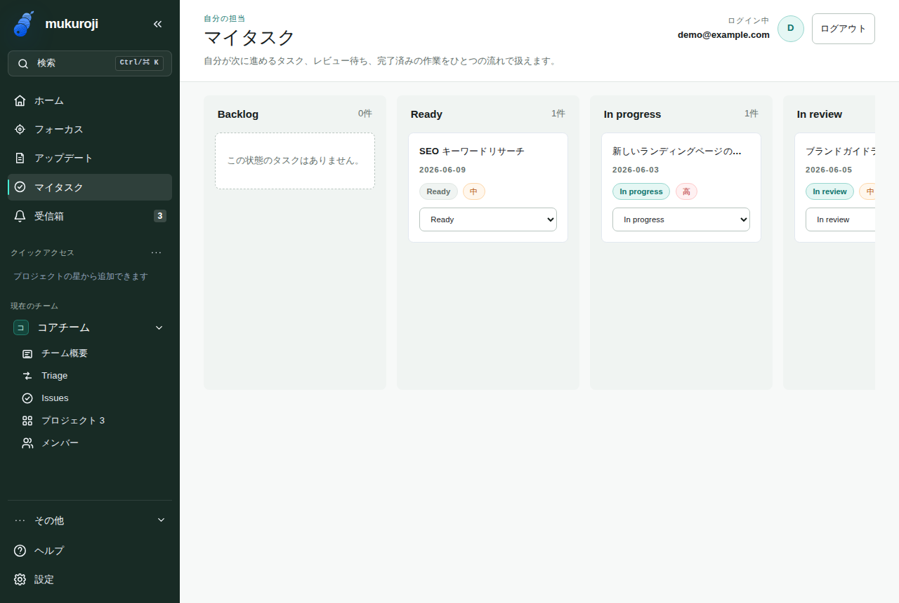
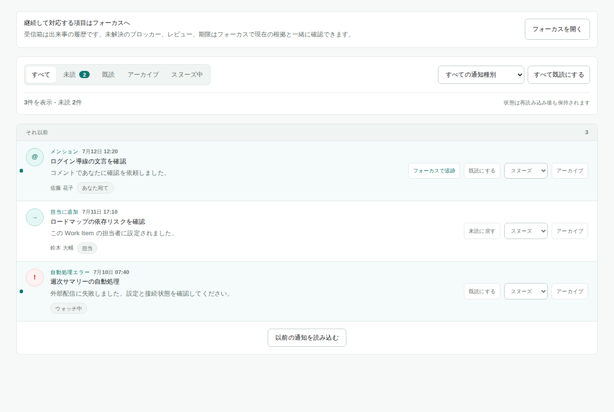

# メンバーガイド

日々の作業で使う画面の使い方です。サイドバーの上から **ホーム / フォーカス / アップデート /
マイタスク / Work Item 一覧 / 受信箱** を主に使い、**その他** の下に リクエスト・顧客・コレクション・ドキュメント・
ダッシュボード・プランニング・レポート があります。どの画面からでも **検索**（`Ctrl` / `⌘` + `K`）で
タスクや Project に移動できます。一致するタスクが多い短い語でも、Project の候補は最大 4 件まで結果の末尾に残ります（Project の候補だけ読み込めなかったときは、その旨と再試行ボタンを出します）。

## 1日の流れ

1. **受信箱** で自分宛ての通知を確認する
2. **フォーカス** で、いま対応すべきもの（ブロッカー、期限超過、レビュー依頼など）を片付ける
3. **マイタスク** で担当タスクの状態を進める
4. 作業した時間を **工数** に記録する
5. 週の終わりにタイムシートを提出する

## ホーム

`/home` は、自分に関係する未完了の仕事を「要確認 / 作業中 / 次に着手 / 待機」に分けて並べた
「共同作業キュー」です。チームや段階で絞り込み、**確認する** でタスクを開くか、
**フォーカスで開く** でフォーカス画面へ移ります。

## マイタスク

`/my-tasks` は、自分が責任者のタスクと、Contributor として参加しているタスク（「参加」と表示）を
状態ごとの列に並べたボードです。

- カードを別の列へドラッグすると状態が変わります。
- 上部の **ボード / テーブル / ガント / カレンダー** で表示を切り替えられます。
  - **テーブル** は担当タスクを期限の早い順に 1 行ずつ並べた一覧で、Team や Project をまたいで見渡せます。
    タスク名を押すとタスク詳細が開き、行の **…** から操作メニューを開けます。並び順・グループ・列は **表示設定** で変えられます。
    編集できるタスクは、**期限** と **優先度** をその場で変えられます。期限は変更前後（依存関係で動くタスクを含む）を
    確認してから **適用** で保存します。期間や Milestone の日程はガントかタスク詳細で変えます。
    表の下の **CSV で書き出す / Excel で書き出す** で、表示中の行と列をそのまま file にできます（ガントにも同じボタンがあります）。
  - **カレンダー** は期限の日にタスクを並べた月ごとの表示で、**前の月 / 今月 / 次の月** で月を移ります。
    表示中の月に予定があるタスクと、予定のないタスクが出ます。カードを押すとタスク詳細が開きます。
    カードを別の日へドラッグ（またはフォーカスして左右の矢印キー）すると、変更前後を確認してから日程を変えられます。
  - **ガント** のバーも、ドラッグや矢印キーで同じように日程を変えられます。
- 一覧の上の **自分のタスクを追加** に名前・作成先（Team または Project）・期限を入れて **追加**（または `Enter`）すると、
  自分が担当するタスクを作れます。追加後もタスク名の欄にフォーカスが残るので、続けて入力できます。
  Team が必須項目を決めている場合は、Team の画面から作成します。
- **表示設定** でグループ・並び順・表示する列・密度を変え、完了済みやアーカイブ済みの表示を切り替えられます。
  よく使う表示は「新しいビューとして保存」で保存できます。
- `J` / `K` でカード（テーブルでは行）を移動、`Space` で開きます。

## Work Item 一覧

`/work-items` は、閲覧できるすべての Project の Work Item を Project ごとにまとめて、表・ボード・ガントで見る画面です。
複数の Project を受け持つ人が、Project をまたいで仕事を見るときに使います。
閲覧権限のない Work Item は含まれません。

- **Project** で表示する Project を選びます（複数選択できます）。何も選ばなければすべての Project です。
- **参加メンバー** と **ジョブロール** で、Contributor として割り当てられた人や役割で絞り込みます。
- **自分が責任者または参加** にチェックすると、自分が責任者か Contributor の Work Item だけになります。
- **グループ** で Project ごとか担当者（責任者）ごとかを切り替えます。
- **テーブル / ボード / ガント** で表示形式を切り替えます。ボードはグループごとのレーンに状態の列を並べ、
  ガントはグループごとの見出し行の下に日程を並べます（倍率・1 行表示・印刷・画像書き出しはマイタスクのガントと同じです）。
  どちらも見るための表示で、状態や日程はここでは変えられません。カードやバーを押すとその Work Item を開くので、
  変更は開いた先の Project や Team の画面で行います。
- 初めは未完了の Work Item だけです。**完了・中止も表示** で完了・中止も含めます。
- 絞り込み・グループ・表示形式は、上部のビューの操作でビューとして保存できます。**新しいビューとして保存** で
  名前と公開範囲（自分だけ / Team / Workspace 全体）を選びます。Workspace 全体への公開は Workspace の管理者だけです。
  保存したビューは上部のビュー名から選び直せ、お気に入り・ピン留め・自分の既定にもできます。
- 保存前の変更は「一時的な変更」として URL に残るので、リンクのコピーボタンでほかの人に送れます。
  共有したビューやリンクを開いた人には、その人が閲覧できる Project と Work Item だけが表示されます。
  閲覧できない Project やメンバーの条件は外れ、ビューの上に「利用できない表示設定を取り除きました。」と出ます。
  選ばれた Project がすべて閲覧できない場合は、Project の欄が「閲覧できない Project」になり、一覧は空になります。
  Project を選び直すか、選択を解除すると表示されます。
- 行の Work Item 名を押すとタスク詳細が開きます。

## タスク詳細

タスクを開くと「タスク詳細」が表示されます。キー（例: `PT-12`）が分かっている場合は
`/browse/PT-12` で直接開けます。コメントや説明に書いたキーは、Workspace にあるキーの形（例: `PT-`）のものだけ
リンクになります。`UTF-8` のような語はリンクになりません。

タスク詳細は Project の画面でも Team の **Issues** の画面（マイタスクから開いたときも同じ）でも、同じ欄と操作が並びます。
見出しの下のキーはコピーやリンクの共有に使え、「ファイル」には外部リンクと関連ドキュメントが出ます。
「スケジュール」には予定と実績の開始日・終了日の比較が出ます。実績日の修正、ベースラインの記録、顧客への影響の表示は
Project のデータを使うため、Project の画面だけにあります。

- **ステータス・責任者・優先度（高 / 中 / 低）・説明** を変えて **変更を保存** を押します。
  他の人が先に更新していた場合は保存できないので、再読み込みしてからやり直してください。
- **説明** は Markdown で表示されます（見出し・箇条書き・表・コード・リンク）。**編集** で書く欄に切り替え、
  **プレビュー** で表示を確かめます。本文中のキー（例: `PT-12`）はそのタスクへ、
  Document のパス（例: `/documents/<ID>`）はその Document へのリンクになります。コメントでも同じです。
  HTML は実行されず、外部サイトの画像は読み込みません。
- **画像・ファイルの添付**: 説明とコメントの書く欄にスクリーンショットを貼り付けるか、ファイルをドロップするか、
  **画像・ファイルを添付** を押すと、タスクのファイルとしてアップロードされ、本文に ``
  の形で入ります。コメントは投稿前でも添付できます。1 ファイル 25 MB まで、形式は「ファイル」に追加できるものと同じです。
  画像（PNG・JPEG・GIF・WebP・AVIF）は本文の中に表示され、それ以外はダウンロードボタンになります。
  安全性の確認（ウイルススキャン）が終わるまでは「安全性を確認しています」と表示され、ブロックや失敗になったファイルは
  表示されません。ファイルを見る権限のない人（Guest 閲覧を許可していないファイルの Guest など）には「表示できない添付です」と出ます。
- **コメント**: 「会話」タブで Markdown と `@` メンションが使えます。返信、編集、削除のほか、
  決まったことを **判断に追加** で「判断」タブに残せます。
  メンションできるのは、そのタスクを見られる人です。Project のメンバー登録のほか、
  Enterprise ロール（Directory group mapping や個人へのロール割り当て）で見られる人も選べます。
  書いている途中でログインが切れても、同じブラウザのタブで同じアカウントに再ログインすると、
  そのタスクを開いたときに書きかけの新しいコメントが戻ります（1 日以内）。別のアカウントで
  ログインした場合や、自分でログアウトした場合は残りません。返信と編集中のコメントはまだ対象外です。
- **受け入れ条件**: 何をもって完了とするかを書きます（最大20件）。
- **活動**: 「活動」タブに、誰がいつ何を変えたかが残ります。親・子・ブロック・関連の追加や解除は、
  関係する両方のタスクの活動に表示されます。相手のタスクは、あなたが見られる場合だけキーとタイトルが
  リンクで表示されます（親の変更では変更前と変更後の親）。見られないタスクや削除済みのタスクは名前を出しません。
  Public API でタスクを削除したときも、つながっていた相手のタスクの活動に解除として残り、
  ブロックしていたタスクが消えた側にはブロック解除の通知が届きます。
- **承認を依頼**: 上長などに承認を求めます。承認者に選べるのは、タスクとファイルを見られる人です
  （メンションと同じく Enterprise ロールで見られる人も含みます）。
- **アーカイブ**: タスクを一覧・ボード・ガントから外します。削除ではないので、チームの Issue 画面と
  プロジェクトのタスク画面にある「アーカイブ済み Work Item」から 1 件ずつ **復元** できます。
  編集できないタスクではボタンが表示されません。
  - WBS で子を持つタスクは、子をすべてアーカイブするか別の親へ移してからアーカイブします。
    親子をまとめて選んだ一括アーカイブは、そのままアーカイブできます。子をアーカイブし終えたら、
    もう一度アーカイブを押すと確認し直します。
  - 親がアーカイブされている子は復元できません。親を先に復元してください。
  - アーカイブと復元は、タスク詳細の「アクティビティ」に誰が行ったかが残ります。
  - Web からは削除できません。不要になったタスクはアーカイブします。誤って作ったタスクもアーカイブで
    一覧から外せ、あとから復元できます（削除は Public API だけで行えます）。
- **複製**: タスク詳細の **複製** ボタン、または一覧・ボードの行メニュー（右クリックか `…`）の **Work Item を複製** で、
  元のタスクの名前・説明・Type・custom field・優先度・期日・責任者・Contributor の計画・受け入れ条件を写した作成フォームが開きます。
  保存するまで作成されないので、写した内容を直してから保存してください。Contributor の計画は
  チェックを外すと引き継ぎません。受け入れ条件は文言だけを写し、すべて未達成から始まります。
  履歴・コメント・関連・Run は引き継ぎません。
  チームの Issue 画面とプロジェクトのタスク画面のどちらでも使えます。
- **テンプレートから作る**: 作成フォームの **テンプレート** で Work Item テンプレートを選ぶと、テンプレートの
  名前・説明・Type・優先度・custom field・受け入れ条件が入った状態で始まります。期日はテンプレートから取らず、
  フォームの値のままです。選び直すと入力中の内容は置き換わります。テンプレートは管理者がオートメーションの
  **テンプレート** で作り、停止中のものと別 Team 用のものは出ません。作成フォームでは受け入れ条件を足したり直したりもできます。
- **エージェントへ引き継ぐ**: 保存済みの内容と作業手順を、coding agent に渡す文章としてコピーします。
  コピーしても担当者や状態は変わりません。コメント・添付・未保存の編集は含まれません。
  詳しくは [coding agent 利用者ガイド](coding-agent.md) を参照してください。

## フォーカス

`/focus` は「いま自分が対応すべきこと」だけを優先度順に並べる画面です。履歴ではなく、
原因が解消すると自動的に消えます。

- 区分: **いま / 次 / 待機中 / スヌーズ中 / 完了**（完了は30日間表示）
- 入る理由: ブロッカー、緊急、期限超過、期限間近、承認待ち、レビュー依頼、メンション、SLA 超過、サイクル期限、
  ベースラインより遅れ
- **ベースラインより遅れ** は、Project のベースラインを保存した後に、自分が担当または参加している未完了のタスクの
  予定終了日がベースラインより一定の日数（既定 3 日）以上遅れたときに出ます。日数は WBS 表・Team 一覧の
  「ベースライン比の遅れ」と同じです。予定終了日を戻すか、PM がベースラインを保存し直すと消えます。日数は
  「フォーカスの優先ルール」の「ベースラインより遅れとみなす日数」でチームまたは個人ごとに変えられます。
- 各項目に「なぜフォーカスに入ったか」「解消条件」「順位の根拠」が表示されます。
- その場で **完了にする / 自分を担当にする / 状態を変更 / 期限を設定 / スヌーズ / ウォッチ** ができます。
  スヌーズは 今日の午後 / 明日の朝 / 1週間後 / 日時を指定 から選びます。
- 並び順の重みは「フォーカスの優先ルール」で個人またはチーム単位に調整できます。

## 受信箱と通知

`/inbox`（受信箱）には、担当への追加、メンション、コメントと返信、状態の更新、期限（間近・超過）、
承認、自動処理のエラー、近況の更新・悪化、更新の督促・エスカレーション、Triage の割り当て、
担当またはウォッチ中の Work Item をブロックしていた項目の解除（ブロック解除）などが届きます。

- Work Item の通知には、タイトルの前にキー（例: `PT-12`）が表示されます。メールと Slack の通知にもキーと、
  キーのページ（`/browse/PT-12`）へのリンクが付きます。
- **すべて / 未読 / 既読 / アーカイブ / スヌーズ中** と通知の種類で絞り込めます。
- 既読・未読、スヌーズ（1時間後 / 明日の9時 / 1週間後）、アーカイブができます。
  **すべて既読にする** はアーカイブ済みとスヌーズ中には効きません。
- 通知の左のチェックで複数を選び、**選択を既読にする** と **選択をアーカイブ**（アーカイブの一覧では **選択を戻す**）で
  まとめて操作できます。選べるのは読み込み済みの通知だけで、絞り込みを変えると選択は外れます。
  更新できなかった通知は選択したまま残るので、もう一度実行できます。50 件を超えて選んでも、まとめて処理されます。
- 通知の概要は表示設定の言語で出ます。Slack とメールの概要も、受け取る人の表示設定の言語で届きます（未設定は日本語）。
  以前から届いている一部の通知は、届いたときの文言（英語）のまま表示されます。
- 対応が必要なものは **フォーカスで追跡** でフォーカスに入れます。受信箱で既読・アーカイブにしても、
  フォーカスの項目は解消しません（原因を解消すると消えます）。

通知の受け取り方は **設定** → **個人**（`/settings/personal`）→ **通知設定** で変えます。配信チャネル（アプリ内 / メール / プッシュ / Slack）、
頻度（即時 / 1時間ごと / 毎日 / 毎週）、通知しない時間帯を選べます。メールは、管理者が送信元を設定した環境で、
Cognito に登録して確認済みのメールアドレスへ届きます。頻度が即時なら通知ごとに 1 通、1時間ごと・毎日・毎週なら、最初の通知からその時間が過ぎたときに、それまでにたまった通知を 1 通のまとめメールで受け取ります。
メールが届かず戻ってきた（bounce）場合や、迷惑メールとして報告した場合は、そのアドレスへのメールが止まります。メールアドレスを変えると再開します。同じアドレスで受け取り直したいときは、管理者にメール配信停止の解除を依頼し、解除されてから通知設定でメールを一度無効にして有効にし直してください。
プッシュは、管理者が VAPID 鍵を設定した環境で、**このデバイスのプッシュ通知** で登録したブラウザやアプリに届きます。どれか 1 台に届けば送信済みになり、使われなくなった端末の登録は自動で消えます。送信元や鍵が未設定の環境では、配信チャネルのメール・プッシュに **無効** と表示され、選んでも設定が保存されるだけです。
Slack は管理者の設定が必要です。

**種類ごとの配信先** では、通知の種類（メンション / 承認 / 担当 / 状態の変更 / 期限・日程 / コメント / ヘルス更新 /
工数・週報の提出 / その他）ごとに受け取るチャネルを選べます。たとえば「状態の変更はアプリ内だけ、期限は Slack にも」と
設定できます。上の配信チャネルで切っているチャネルは、種類ごとに選んでも届きません。1 つの通知は 1 つの種類に入り、
メンションを含むコメントはメンション、担当と状態が同時に変わった更新は担当として扱います。

**ミュート** では、Team 全体または Project ごとに通知を止められます。ミュートした範囲の通知はどのチャネルにも届かず、
受信箱ではアーカイブに入ります（アーカイブの一覧で見られます）。**ミュート中もメンションは受け取る** と
**ミュート中も承認は受け取る** を有効にしておくと（既定で有効）、その 2 種類だけはミュート中も届きます。
設定を変えると次に届く通知から反映され、送信待ちの Slack・メールも送る直前に設定を確かめ直します。

同じ画面の **リマインドの日数** で、自分あての期限前通知・期限超過の再通知・未更新の督促・工数の督促が
何日で届くかを変えられます。空欄の項目は Team の設定を使い、Team も決めていなければ既定値
（期限前通知は 3 日、それ以外は 7 日）を使います。工数の督促は 1〜31 日、それ以外は 1〜365 日です。
Project manager への escalation の日数は Team の設定だけで決まり、個人では変えられません。

## 工数を記録する

### タスクから記録する

タスク詳細の「工数」欄で記録します。

- **タイマー**: **タイマー開始** → 作業後に **停止して記録**（下書きとして保存）。不要なら **破棄**。
  同時に動かせるタイマーは1つです。
- **手入力**: **手入力で追加** で「日付」「開始」「終了」「メモ」「請求対象」を入れて **追加**。

欄には見積・実績・残り・超過と、直近90日の自分の記録が表示されます。

### 会議などの間接作業を記録する

タスクに紐づかない会議・管理・教育などは、Team の **工数** の **自分のタイムシート** で
**間接作業を追加** から記録します。「作業区分」「プロジェクト」「日付」「時間数（h）」「メモ」「請求対象」を入れて **追加**。

- 作業区分は Workspace の管理者が決めたものから選びます。管理者が使うのをやめた区分は新しい記録では選べませんが、
  その区分で記録済みの工数は区分を変えずに編集できます。

- 時間数は `1.5` や `1:30` のように入れます。その日の 24 時間までです。開始・終了の時刻は記録しません。
- プロジェクトは、自分がメンバー以上のプロジェクトから選びます。**プロジェクトなし** は、プロジェクトに属さないタスクに
  記録できる人だけが選べます。
- 記録は通常の工数と同じく下書きになり、提出・承認・集計・CSV に含まれます。タイムシートの表では作業区分ごとの行
  （「間接作業・会議」など）にまとまります。
- 開始・終了の時刻つきで記録された間接作業を編集するときは、日付と時間数を変えなければ時刻はそのまま残ります。
  日付か時間数を変えると、日付と時間数だけの記録になります。

### タイムシートを提出する

Team の **工数**（`/teams/:teamId/timesheet`、「工数とタイムシート」）の **自分のタイムシート** で、
週ごと（管理者が決めた曜日始まり。決めていなければ月曜始まり）の記録を確認し、**下書きをまとめて提出** を押します。

記録は 下書き → 提出済み → 承認済み → ロック済み と進みます。差し戻されたら理由を確認して修正し、
再提出します。Team の管理者は **承認** 表示で承認・差し戻し・ロックを行います。

下書きと差し戻しの記録は、**削除** → **この下書きを削除** で消せます。消せるのは自分の記録だけで、
提出済み・承認済み・ロック済みは消せません。削除は監査ログに残ります。

- 1件の記録は7日を超えられません。
- Team が **工数の記録チェック** を有効にしていると、手入力で記録を追加したときや記録の時間を変えたときに、
  ほかの記録と時間帯が重なるか、1日の合計が Team の上限を超えると、保存後に警告が出るか、保存できません。
  保存できないときは時間帯を直すか、Team の管理者に相談してください。タイマーを止めたときは確かめないので、
  重なっていても上限を超えていても警告は出ず、そのまま保存されます。
- 管理者が月を締めると、その月の記録は追加・修正・提出・削除できません。直したいときは管理者に締めの解除を頼みます。
- 承認済み・ロック済みの記録でも、管理者が理由を付けて差し戻すことがあります。差し戻された記録は
  通常の差し戻しと同じく理由を確認して修正し、再提出します。
- Project に属さないタスクの記録とプロジェクトなしの間接作業も自分のタイムシートに表示され、Team の管理者（Team のどれかの Project の管理者）が承認します。
- タイムシートと集計に出るのは自分の記録だけです。ほかのメンバーの工数は見えません。
  ただし集計の単位を「タスク」にしたときと、タスク詳細の工数欄の実績は、見られるタスクについて全員分の合計です。
- 記録が終わってから一定の日数（既定 7 日）たっても下書きか差し戻しのまま残っていると、受信箱に
  「工数の提出」の督促が Project ごとに届きます（日本時間 9 時。未提出が残る間はその日数ごとに繰り返し）。
  開くと最も古い未提出の記録の週が表示されます。同じ Project の未提出記録をすべて提出すると督促は止まり、Slack やメールで送る予定だった督促も届きません。一部の週だけを提出した場合は、残りの未提出記録について督促が届くことがあります。対象は直近 92 日の Project に属する記録です。
- 工数欄が出ない業務の種類がある場合は、管理者に設定を依頼してください。

### 複数の Team の工数をまとめて提出する

いくつもの Team で作業しているときは、**Team 横断の稼働**（`/workload`。Team メンバー画面の要員計画にある
**全 Team の稼働を見る** から開きます）の **自分の工数（全 Team）** で、所属する Team ごとの1週間の記録を一つの表で確認できます。
**全 Team の下書きをまとめて提出** を押すと、すべての Team の下書きと差し戻しの記録が提出され、
それぞれの Team の管理者が今までどおり承認します。提出できなかった記録があれば件数が出るので、もう一度押します。
表に出るのは自分の記録だけです。

### 週報を作る

Team の **工数** の **週報** で週を選ぶと、自分が担当・協力しているタスクと、その週に自分が記録した工数から
週報の下書きが作られます。

- **今週やったこと**: その週に完了したタスクと、着手したタスク
- **来週やること**: 進行中のタスクと、来週末までに開始・期限を迎えるタスク
- **課題**: 期限を過ぎて未完了のタスク
- **実績工数**: 週の合計とタスクごとの内訳（間接作業は作業区分ごと）

**課題・相談したいこと** と **所感** を書き足して、次のどれかを押します。

- **下書きを保存**: 課題と所感を保存します。あとで開き直すと続きから書けます。保存した下書きは自分にしか見えません。
- **提出する**: その時点のタスク・工数・課題・所感を週報として提出します。Team の管理者（Workspace の owner / admin、
  またはあなたが参加している Project の manager）が読めるようになります。提出した版は変更できません。
  直したいときは書き直して **再提出する** を押すと、新しい版として残ります（1 週あたり 10 版まで）。
- **Markdown をコピー**: チャットや Document に貼り付けます。

週報の状態（未提出 / 提出済み・第何版）は所感欄の上に、提出した内容は **提出した内容** に表示されます。
左下の **これまでの週報** から過去の週を開けます。

Team・Project 全体のその週の完了・遅れ・期限超過・マイルストーン到達は、**工数** の **週次まとめ** で見られます
（あなたが見られるタスクだけを数えます。詳しくは [PM ガイド](pm.md#teamproject-の週次まとめを見る)）。

その週の週報を金曜 17 時（日本時間）までに提出していないと、「週報の提出」の通知が届きます。
開くとその週の週報が表示されます。月曜 10 時になっても提出していないと、あなたが参加している Project の
manager にも通知が届きます。曜日・時刻は Workspace の owner / admin が **テナント管理** で変えられます（止めることもできます）。
提出したあとは、Slack やメールで送る予定だった督促も届きません。

見られないタスクは週報に出ません。提出した週報を読む人にも、その人が見られないタスクは名前を伏せて
「閲覧権限のないタスク」と表示されます（工数だけは合計に残ります）。間接作業はタスクではないので、
作業区分と時間数がそのまま提出され、読む人にも表示されます。課題と所感はそのまま読まれるので、
相手に見せたくないタスクの名前は書かないでください。

## 休暇を申請する

Team の **メンバー**（`/teams/:teamId/members`）の要員計画で、自分を選んで「休暇・不在」に日付を入れ **休暇を保存** を押します。
申請した休暇は「休暇の申請と承認」に「承認待ち」で出て、Team の管理者が承認するとキャパシティから引かれます。
承認・却下されると通知が届きます。予定がなくなったら **取り下げ** を押します。却下された休暇は **再申請する** で承認待ちに戻せます。承認済みの休暇の日付を変えると、承認待ちに戻ります。

## 依頼を出す・受ける

- **社内外からの依頼**: 管理者が作ったリクエストフォームの公開リンク（`/request/...`）から送信します。
  送信後に表示される受付番号と返信スレッドで、追加情報のやりとりができます（「追加情報を送る」）。
- **Triage**: 届いた依頼は Team の **Triage**（`/teams/:teamId/triage`）に入ります。
  Triage 担当は「受付（Work Item を作成、または既存の Work Item にリンク）/ 重複として統合 /
  見送る / 追加情報を依頼 / スヌーズ / ルーティングを変更」から選び、「内容を確認して実行」で確定します。

## そのほかの画面

| 画面 | 使いどころ |
| --- | --- |
| **アップデート**（`/updates`） | Project の近況を読む。既読管理、前回との比較、コメント・リアクション。自分用のフィードも作れる。「受信トレイのダイジェスト設定」をオンにすると、未読の Update を日次（毎日）または週次（毎週月曜）に 1 件のダイジェストとして受信トレイで受け取れる（UTC 0:00、日本時間 9:00 以降に届く。開くと今の権限で見られる内容だけが表示される。運用者が配信を止めている間は、設定は保存されたまま届かない） |
| **ドキュメント**（`/documents`） | ページ・Wiki・ホワイトボード・テンプレート。議事録・設計書・振り返りの同梱テンプレートで日付・Project・参加者入りのページを作れ、貼り付けた Markdown や Markdown ファイル 1 つからもページを作れ（「フォルダごと取り込む」ではフォルダの階層をそのまま Document のフォルダにし、ファイル間の相対リンクを取り込んだページへのリンクにする。200 ファイルまで）、チェック項目には担当者と期限を付けられ（期限を過ぎた未完了の項目は「期限切れ」と表示。公開リンクには出ない）、チェック項目やホワイトボードの付箋の「Work Item にする」で宿題を Work Item にできる（チェック項目の担当者と期限が最初から入る。その Work Item を完了にすると元のチェック項目と付箋も完了になる）。コメントでは `@` に続けて名前を入力し、候補から選んでメンションできる。「共有とアクセス」でメンバー権限と期限付きの公開リンクを設定 |
| **コレクション**（`/collections`） | Team や Project をまたいでタスクを束ねる。タスクを複製せず、見える範囲も広げない |
| **検索**（`/search`） | Work Item・Project・ドキュメント・コメントを横断検索。Work Item と Project を先に探し、keyword に一致するタイトルは件数の多い Workspace でも最初の page から出す。タイトルの一致は page をまたいで本文だけの一致より上に並ぶ（本文だけの一致は続きの page に出ることがある）。「複合 filter」の担当者・作成者・チーム・プロジェクトは名前で選べる（一覧にない ID も入力して絞り込める）。表示モードの切り替えと保存ビュー。ファイルは検索の対象外なので「種類」の絞り込みに出ない（以前の URL・保存ビュー・AI の下書きで「ファイル」が選ばれている場合だけ表示され、押すと外せる） |
| **ヘルプ**（`/help`） | 役割別の利用者ガイドへのリンクと、主な画面（プロジェクト・計画・アップデート・レポート・マイタスク・フォーカス・受信箱・設定）の短い説明。各機能の「画面を開く」でその画面へ、「ガイドを読む」でこのガイドの該当箇所へ移動する。不具合を報告するときは、ここに出る稼働中の Web build の commit を伝える |
| **顧客**（`/customers`） | 顧客、連絡先、顧客からの要望と関連タスクを確認する。顧客を管理できるメンバーは顧客・連絡先・要望の登録と編集、保存ビューの管理、エクスポート、重複の統合もできる（[管理者ガイド](admin.md#顧客台帳の管理)） |

## 表示と言語

**設定** → **個人** の「プロフィール」で、ほかのメンバーに表示される名前（表示名）を変えられます。
表示名は担当者の一覧・コメント・週報などに出ます。空にするとメールアドレスで表示されます。
ディレクトリ（SCIM）連携で作られたアカウントの表示名はディレクトリが管理するため、ここでは変えられません。

**設定** → **個人** の「表示設定」で、文字サイズ（小さめ / 標準 / 大きめ）、配色（ライト / ダーク / システム）、
言語、タイムゾーンを変えられます。変えた設定はアカウントに保存され、別の端末でログインしても同じ設定で始まります。
タイムゾーンは「ブラウザの設定」のままにすると、その端末の設定に従います。通知設定を一度も保存していないときに「通知しない時間帯」を初めて有効にすると、ここで選んだタイムゾーンが入ります。通知設定を保存したことがあれば、保存済みのタイムゾーンがそのまま使われます。「アプリとしてインストール」で PWA としてインストールすると、通知バッジも使えます。

## 予定を自分のカレンダーに表示する

**設定** → **個人** の「カレンダー連携」で、予定を Google カレンダー・Outlook・Apple カレンダーに
表示する URL（iCalendar 形式）を発行できます。

- **自分の予定**: 自分が担当または協力している未完了のタスクの期限・期間と、そのタスクの Project の
  マイルストーン・Cycle、自分が担当のマイルストーン・Cycle が出ます。
- **Project の予定**: 選んだ Project の未完了のタスクの期限・期間と、その Project のマイルストーン・Cycle、
  Team 全体の Cycle が出ます。自分が見られる Project だけ選べます。
- 「URL を発行」を押すと URL が一度だけ表示されます。カレンダーアプリの「URL で追加」（Google カレンダーは
  「他のカレンダー」→「URL で追加」）に貼り付けるか、「カレンダーアプリで開く」を押します。
- URL を知っている人は誰でも予定を見られます。漏れたときは「URL を再発行」を押すと前の URL は使えなくなり、
  「停止」を押すとその URL は見つからない（404）になります。
- 予定は読み込まれるたびに今の権限で作り直します。Project を見られなくなると、その Project の予定は消え、
  Project の予定の URL は 404 になります。Workspace のメンバーでなくなったときや Workspace を閉じたときも 404 です。
- タスクの期限を変えると、カレンダーアプリが次に読み込んだときに反映されます。読み込みの間隔はアプリが決め、
  Google カレンダーは数時間かかることがあります。カレンダー側で予定を動かしても Mukuroji には戻りません。
- 未完了のタスクが多すぎて一度に読み切れないとき（日付のあるタスクが 1,000 件、マイルストーンと Cycle が 300 件を超えるときを含む）は、予定が欠けたまま表示しないよう、カレンダーアプリには
  読み込みエラー（413）になります。完了したタスクを閉じるか、Project ごとの予定に分けてください。

## メンテナンス中の表示

運用者が移行作業や障害対応でメンテナンスに切り替えると、画面の上に黄色の「メンテナンス中」のバナーが出ます。
障害ではありません。

- **閲覧だけできるメンテナンス**: 画面は今まで通り見られますが、保存・作成・削除などの変更はできません。
- **一時停止のメンテナンス**: 画面の読み込みもできなくなります。

どちらの場合も、保存できなかった入力は画面に残っています。再読み込みせずに待ち、バナーが消えてから保存し直して
ください。バナーはメンテナンスが終わると自動で消えます。

## 画面とサーバーのバージョンが違うとき

開いたままの画面が、更新されたサーバーと違うバージョンのままになると、画面の右下（スマートフォンでは下）に
「画面とサーバーのバージョンが異なります」と出ます。**再読み込み** を押すと画面がサーバーに合わせて更新されます。
入力中の内容がある場合は、保存してから押してください。**後で** を押すと、画面を読み込み直すかサーバーがまた更新されるまで出ません。

再読み込みしても同じお知らせが続くときは、更新の途中の可能性があります。数分待ってからもう一度再読み込みしてください。

画面を読み込めなかったときは「このページを読み込めませんでした」と出て、エラーの種類（入力内容や画面の中身は含みません）が
運用担当に自動で送られます。画面に出る「エラー ID」を伝えると、運用担当が記録を探せます。
オフラインのときや送信が多すぎるときは送られないことがあり、その場合は ID で記録が見つかりません。

## 詳しい仕様

- フォーカス: [`docs/focus.md`](../focus.md)
- 通知と受信箱: [`docs/notifications.md`](../notifications.md)
- コメントと共同編集: [`docs/collaboration.md`](../collaboration.md)
- 工数: [`docs/time-tracking.md`](../time-tracking.md)
- Triage: [`docs/triage.md`](../triage.md)、依頼フォーム: [`docs/request-intake.md`](../request-intake.md)
- コレクション: [`docs/collections.md`](../collections.md)、ドキュメント: [`docs/documents.md`](../documents.md)
