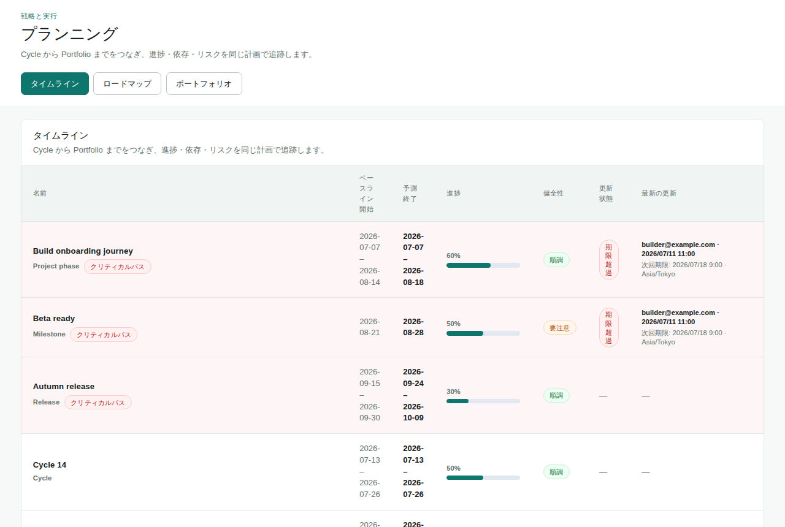
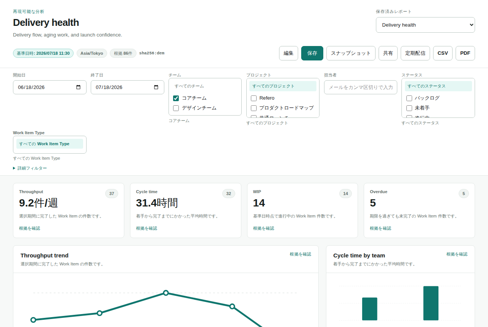

# PM ガイド

Project を立ち上げてから、WBS を組み、日程と工数を管理し、毎週の近況（health update）を公開し、
Project を終結するまでの流れです。各手順の画面名とボタン名はアプリの日本語表示に合わせています。

```text
1. Project を作る → 2. 憲章とメンバーを決める → 3. WBS を組む → 4. 日程・依存・工数を入れる
→ 5. 計画（Phase・Milestone・Cycle）を置く → 6. 更新スケジュールを決める
→ 7. 毎週、近況を公開する → 8. レポートで振り返る → 9. 終結する
```

## 1. Project を作る

Project を作れるのは Workspace の owner / admin です。PM が owner / admin でない場合は、
管理者に作成を依頼し、作成後に Project の manager にしてもらいます（[管理者ガイド](admin.md#team-と-project-を作る)）。

1. サイドバーの **新規登録** を押し、**プロジェクト** タブを選ぶ。
2. 「登録先チーム」を選び、「プロジェクト名」と「色」を入れて **プロジェクトを登録** を押す。
   チームがまだなければ、先に **チーム** タブでチームを登録します。
3. 作った Project は「実行中」の状態で始まり、`/projects`（すべてのプロジェクト）と
   サイドバーのチーム配下の **プロジェクト** に表示されます。

## 2. 憲章とメンバーを決める

Project を開き（`/projects/:projectId/issues`）、**権限** タブを開きます。

**プロジェクト憲章**: 「プロジェクトコード」「目的」「説明」「責任者（PM）」「スポンサー」
「計画開始日」「計画終了日」「分類タグ」「関連リポジトリ URL」を入れて **憲章を保存** を押します。
憲章を編集できるのは Project の manager と Workspace 管理者です。

**ライフサイクル**: 提案中 → 承認済み → 実行中 ⇄ 保留 → 終結 の順に「{状態}にする」で進めます。
提案中の Project の承認・却下は Workspace 管理者が行います。

**メンバー**: 「権限管理」で Workspace のメンバーを検索し、ロール（manager / member / viewer）を選んで
**ロールを保存** を押します。外すときは **解除** です。Workspace にまだいない人は、先に管理者が招待します。

## 3. WBS を組む

### タスクを登録する

Project の画面上部の **新規タスク**（または **タスクを追加**）から登録します。

- **クイック登録**: タイトルだけで登録し、Triage / Backlog に入れる。思いついた作業を先に並べるとき向け。
- **詳細登録**: 「タスク名」「担当者」（必須）「Work Item Type」を入れて **登録**。

ボードの「この列に追加」、カレンダーの「この日に追加」からも登録できます。

### 階層にする

WBS（親子の階層と WBS 番号 1.2.3）は、Team の **Issues**（`/teams/:teamId/issues`）の **テーブル** 表示で扱います。

1. **表示設定** で「階層（WBS）で表示する」をオンにする。
2. 行を選び、`Alt`+`Shift`+`→` で一つ下の階層へ、`Alt`+`Shift`+`←` で一つ上の階層へ移す。
   `Alt`+`Shift`+`↑` / `↓` で同じ階層の中で並べ替える。
3. 親の行には、子の完了数（完了 x/y）、見積の合計、子の開始〜終了の期間がまとまって表示されます。

既存のタスク同士を親子にするには、タスク詳細の「Work Item の関係」→ **関係を追加** で
「親」または「子」を選びます。親は1つだけで、追加すると今の親から付け替わります。

- 業務の種類（例: フェーズ・成果物・作業）を分けたい場合は、管理者に Work Item Type を作ってもらいます。
  既定では「Work Item」1種類だけです。
- 子が未完了のまま親を完了にしたときの扱い（警告 / 拒否）は Team の設定で決まります。
- 1 Team あたり 1,000 件を超えると階層表示はできません。

Project の画面には **テーブル / ボード / 期限順 / 期限カレンダー / ファイル / 権限** のタブがあり、
**期限順** は期間を横に並べたガントチャート風の表示です。

## 4. 日程・依存関係・工数を入れる

タスク詳細で次を設定します。

- **スケジュール**: 「スケジュール種別」を 未計画 / 期限のみ / 期間（開始日・終了日）/ マイルストーン から選ぶ。
  「予定工数（分）」もここで入れます。
- **スケジュール依存関係**: **スケジュール依存関係を追加** で、終了から開始（FS）/ 開始から開始（SS）/
  終了から終了（FF）/ 開始から終了（SF）と「リード／ラグ（日）」を設定します。日付が動く場合は
  「日程変更を確認」で影響を確認してから確定します。「ブロックする」などの関係（上の「Work Item の関係」）は日付を動かしません。
- **工数と進捗**: 「見積（時間）」「残工数（時間）」「進捗率（%）」を入れて **工数と進捗を保存**。
  進捗率の自動計算方法（ステータス区分 / 見積と残工数 / 手入力）は Team の設定です。
- **責任者と Contributor**: 責任者は1人です。手伝う人は **Contributor を追加**（最大20人）で、
  それぞれの予定工数と状況を持たせます。
- **受け入れ条件**: 完了の判断基準を最大20件書けます。coding agent に任せるタスクでは必須にできます。

メンバーの実績工数は Team の **工数**（`/teams/:teamId/timesheet`）の **承認** 表示で確認・承認します
（[メンバーガイド](member.md#工数を記録する)）。

## 5. 計画（Phase・Milestone・Cycle）を置く

**プランニング**（`/planning`）で、タスクより大きな単位の計画を作ります。タブは
**タイムライン / ロードマップ / ポートフォリオ** です。

1. 「計画を作成」で「計画種別」を選ぶ: Cycle、Milestone、Release、Project phase、Goal / OKR、
   Initiative、Roadmap、Portfolio。
2. 「名前」「オーナー」「上位計画」、対象の Team / Project、開始日と終了日を入れる。
   Cycle は「ケイデンス」「キャパシティ」「繰り越し方針」も決めます。
3. 上位から順に Portfolio → Roadmap → Initiative → Goal / OKR → Project phase → Milestone / Release とつなげます。
4. **タイムライン** で計画同士の依存（**依存を追加**）とクリティカルパスを確認します。
   Cycle の終わりには「未完了を繰り越す」で残りを次の Cycle に移せます。

計画は削除ではなくアーカイブします（「アーカイブ済みの計画を表示」から復元可能）。

**タイムライン** で Cycle を選ぶと **Cycle バーンダウン** が表示されます。Cycle に紐づく Work Item の
残り件数を開始日から 1 日ごとに描き、終了日に 0 になる **理想線** と比べられます。
集計対象は「今その Cycle に紐づいている Work Item」です。途中で外した Work Item は過去の日付からも消え、
途中で足した Work Item は開始日から含まれます。開始前の Cycle と、紐づく Work Item が 500 件を超える
Cycle では表示されません。



## 6. 更新スケジュールを決める

週次の近況報告を習慣にするため、Project の更新欄に「更新スケジュール」を設定します（manager のみ）。

1. **すべてのプロジェクト**（`/projects`）で対象の行の更新リンク（更新詳細を開く）を押す。
   **ポートフォリオ** 画面で、その Project の更新欄が開きます。**ダッシュボード** からも開けます。
2. 「更新スケジュール」に「更新担当者」「更新頻度」（毎日 / 毎週 / 2週間ごと / 毎月）
   「タイムゾーン」「リマインダー（何時間前）」「エスカレーション（何時間後）」「エスカレーション先」を入れ、
   **スケジュールを保存** を押す。

期限が近づくと更新担当者の **受信箱** に督促が届き、遅れるとエスカレーション先にも通知されます。
状態は 更新済み / 未報告 / 情報が古い / 期限超過 で表示されます。

## 7. 毎週、近況を公開する

1. 6 と同じ方法で Project の更新欄を開き、「近況を共有」を表示する。
2. 必須項目を入れる:
   - **健全性**: 順調 / 要注意 / 計画外（リスクを「高」「重大」にすると自動的に「計画外」になります）
   - **リスク**: なし / 低 / 中 / 高 / 重大
   - **要約**: 今週の進捗と結論
   - **次のアクション**
3. 必要に応じて「判断事項」「必要な支援」と、根拠リンク（Work Item、計画、ファイル、HTTPS のリンク）を付ける。
   進捗スナップショットは自動で添付されます。
4. **更新を公開** を押す。

公開した近況は変更できません（「公開済み・変更不可」）。訂正は次の更新で行います。
関係者は **アップデート**（`/updates`）で既読管理・前回との比較・コメント・リアクションができ、
「注意・遅延」「未提出」「提出期限超過」のフィードで遅れている Project を探せます。
AI assistance が有効な Workspace では、「Planning draft を生成」で下書きを作れます。

## 8. レポートで振り返る

**レポート**（`/reports`）で、数値の推移を見るレポートを作ります。

1. 「空のレポートを作成」を押し、「レポート名」「説明」「共有範囲」（個人 / チーム / Workspace 全体）を決める。
2. 「ウィジェットを追加」で指標を置く: Throughput、Cycle time、Lead time、WIP、期限超過、
   Scope change、Velocity、SLA 達成率、完了予測（P50 / P85 / P95）。
   進み具合を見るグラフは、ウィジェットの種類で **バーンダウン**（残スコープと理想線）、
   **バーンアップ**（総スコープと完了）、**累積フロー**（状態カテゴリごとの積み上げ）を選びます。
   バーンダウンの理想線はレポート期間の終了日に 0 になります。
3. 期間・チーム・プロジェクト・担当者などで絞り込み、**保存** する。
4. 週次の会議用には **スナップショット** で再現可能な固定版を残すか、**定期配信** で毎週同じ時刻に
   メンバーの受信箱へ届くようにします（外部メールには送りません）。**CSV** / **PDF** でも出力できます。

**共有** はページの URL をコピーするだけです。見る人はログインしていて、共有範囲に含まれている必要があります。
レポートを社外に公開するリンクはありません。社外向けの資料は **ドキュメント** で作り、
「共有とアクセス」の公開リンク（有効期限 1日 / 7日 / 30日）を使います。



**ダッシュボード**（`/dashboard`）では、ポートフォリオ全体の健全性、更新状態、次の期限、
次に判断が必要なものを一覧できます。

## 9. Project を終結する

1. Project の **権限** タブで「終結にする」を押す。
2. 「プロジェクトを終結しますか？」で **終結する** を押す。

終結後は新しい Issue を作れません。未完了の Issue は残り、閲覧と編集は引き続きできます。
再開する場合は「実行中にする」で戻せます。一覧から隠したい場合は、管理者がアーカイブします
（アーカイブは現在この画面から復元できません）。

## 詳しい仕様

- Work Item の階層、責任者と Contributor: [`docs/work-items.md`](../work-items.md)
- 計画と health update: [`docs/planning.md`](../planning.md)
- 一覧・ボードの表示設定: [`docs/task-views.md`](../task-views.md)
- レポートと定期配信: [`docs/analytics.md`](../analytics.md)
- 工数: [`docs/time-tracking.md`](../time-tracking.md)、要員計画: [`docs/capacity-planning.md`](../capacity-planning.md)
